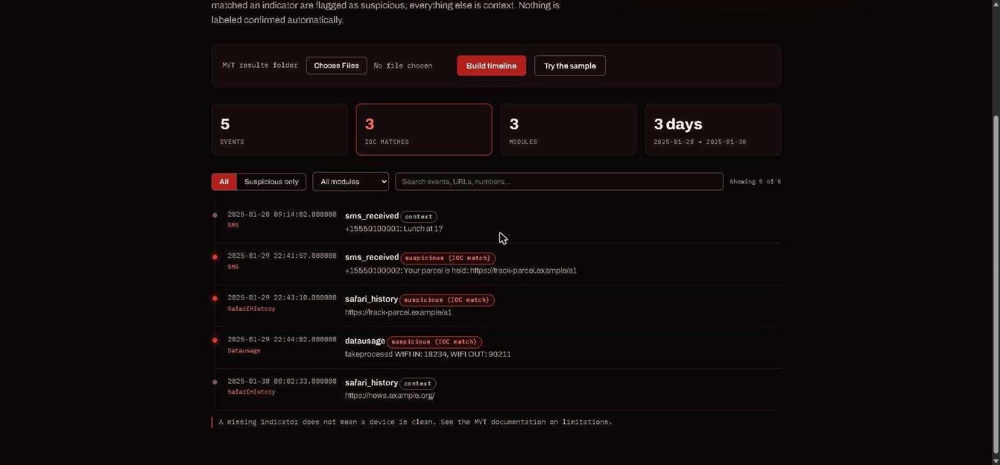

# MVT Timeline Viewer

Turn [Mobile Verification Toolkit (MVT)](https://docs.mvt.re/) results into a readable incident timeline, in your browser.



MVT checks an iPhone backup or Android device against published indicators of compromise (IOCs) and writes a folder of JSON and CSV files. Those files are thorough but hard to read. This viewer puts every event on one timeline and marks which ones matched an indicator.

## What it does

- Reads the folder MVT writes with `--output` (`timeline.csv`, `timeline_detected.csv`, `<module>.json`, `<module>_detected.json`, `info.json`).
- Shows totals (events, IOC matches, modules, time span), then every event in time order.
- Filter to suspicious events only, by module, or by free-text search (URLs, phone numbers, process names).
- Handles large scans: 50,000 events load in well under a second, rendered 200 at a time.
- Labels each event:
  - **suspicious (IOC match)**: the same row appears in `timeline_detected.csv`, meaning MVT matched it against an indicator.
  - **context**: everything else.
- Never labels anything "confirmed". An IOC match is a lead for an investigator, not proof of compromise.
- Runs entirely in the browser. Files are read locally and never uploaded.

## What it does not do

- It does not scan devices or detect spyware itself. MVT does that.
- "No suspicious events" does not mean a device is clean. Indicators only cover known threats, and logs can be missing or overwritten. See MVT's [notes on limitations](https://docs.mvt.re/en/latest/introduction/).

## Try it

Click **Try the sample** to load a bundled, entirely fake result set. The story it tells: a parcel-delivery text with a link, the link opened in Safari two minutes later, and then an unknown process sending data. All indicator domains use the reserved `.example` TLD.

## Use it with your own results

1. Scan with MVT, for example an encrypted iPhone backup:
   ```
   mvt-ios download-iocs
   mvt-ios decrypt-backup -d decrypted/ <backup-folder>
   mvt-ios check-backup --output results/ decrypted/
   ```
2. Open the viewer, choose the `results/` folder, then click **Build timeline**.

> Results contain real messages, browsing history and app usage. Do not commit them or share screenshots of them. The `.gitignore` here excludes `mvt-results/`.

## Run locally

Requires Node 20 or newer.

```
npm install
npm run dev      # http://localhost:5173
npm test         # parser tests (node:test)
npm run sample-data   # regenerate the fake sample folder
```

There is no build step for the viewer itself: `index.html` loads `src/parser/mvt.js` as a native ES module, so any static host (GitHub Pages included) can serve the repo as-is.

## Project layout

```
index.html                     viewer page
src/app.js                     UI: loading, filters, paging
src/parser/mvt.js              pure parser: {filename: text} -> {info, modules, detected, timeline}
src/parser/node.js             reads a folder from disk, for tests and scripts
src/styles/theme.css           styles
tests/unit/parser.test.js      tests
tests/sample-data-generator.js writes the fake sample folder
```

## License

MIT
